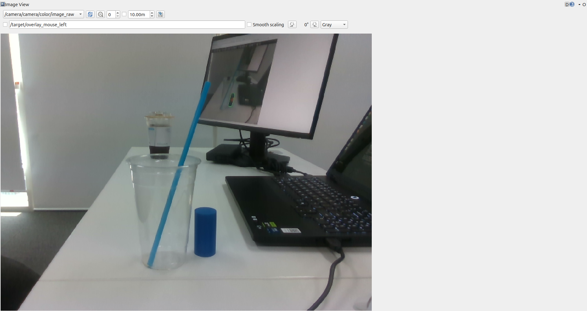
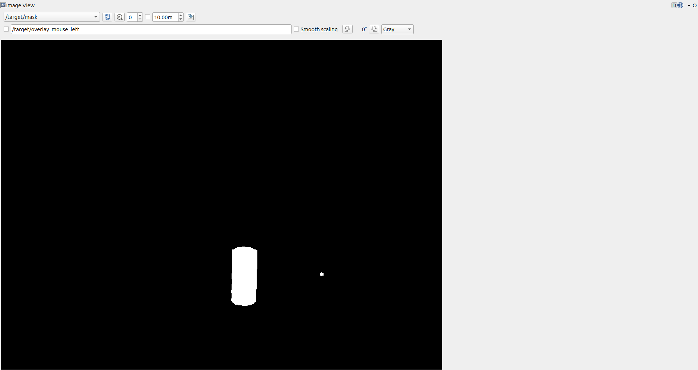
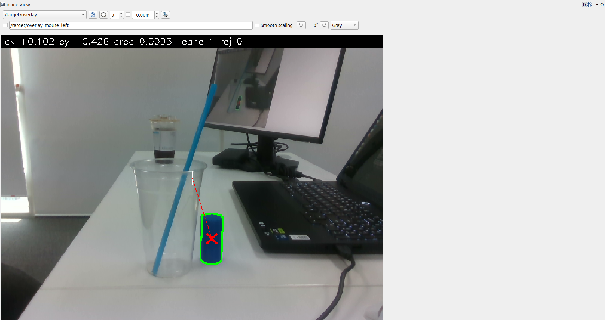
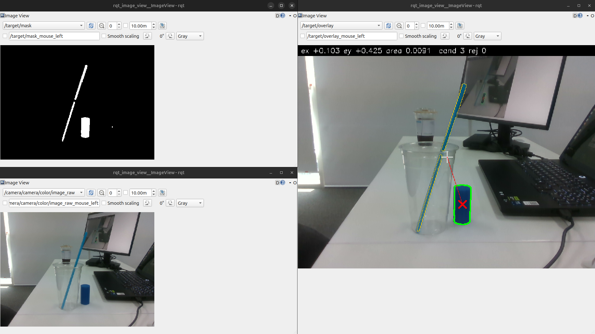
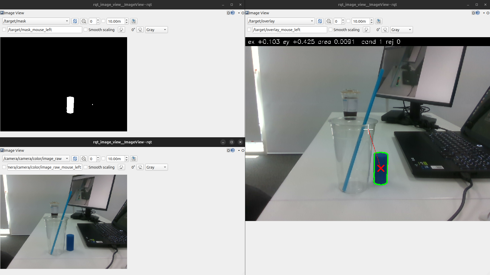
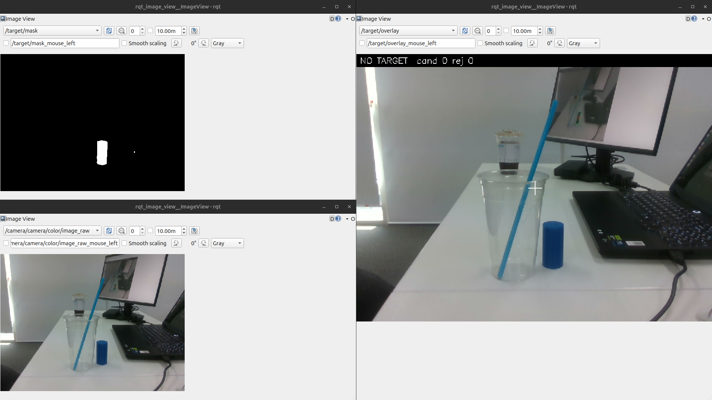
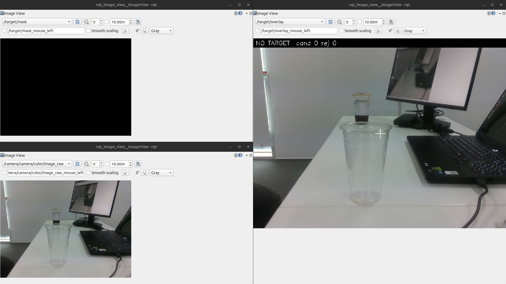

# 모듈 3 보고서 — 설정값에 따른 Mask와 검출 결과 변화 분석

같은 입력 프레임에서 HSV 하한 하나(실험 1)와 최소 Contour 면적 하나(실험 2)를 바꿔, ROS 2 토픽으로 받은 Mask와 검출 결과가 어떻게 달라지는지 비교했다. 실행 방법과 파일 위치는 [README.md](README.md)에 있다.

## 1. 실행 환경과 입력

| 항목 | 내용 |
|---|---|
| 코드 | 팀 저장소 `Lv2_Monglian_Assignment` `lv2-module5-submit`(`cc96e83`)의 검출 노드를 가져와 Mask·Overlay 토픽 발행만 추가 ([README 코드 출처](README.md#코드-출처)) |
| 실행 파일 | `ros2 launch tracker_bringup perception.launch.py camera:=false config_dir:=<실험 설정 폴더>` (검출 노드 `target_detector`) |
| 컴퓨터·ROS 2 | PC, Ubuntu 24.04.5, ROS 2 Lyrical, CycloneDDS, Python 3.12.3, OpenCV 4.6.0 ([environment.txt](results/environment.txt)) |
| 카메라 | Intel RealSense D435, 컬러 640×480 `rgb8` 30 Hz |
| 입력 | **직접 녹화한 rosbag** (실시간 Camera 아님). 같은 장소·같은 환경에서 목표 있음·목표 없음 장면을 각 15.68 s(영상 471장) 녹화 ([bag 정보](results/bag/)) |
| 관찰 구간 | 목표 있음 bag의 **236번째 영상 1장**(header stamp `1791782778.179045410`)을 A·B 모든 실행에 똑같이 넣음. 목표 없음은 같은 bag 번호의 영상(stamp `1791783100.180469971`) 1장과 그 뒤 이어 재생한 약 8 s |
| 한 장 넣는 방법 | `ros2 bag play --start-paused` 후 `/rosbag2_player/seek`, `/rosbag2_player/play_next` 서비스 호출 (`scripts/send_one_frame.sh`) |

모든 실험에서 깊이(`use_depth`), 실제 크기 검증(`size_check`), 번호 유지(`use_object_tracker`)는 껐다. 깊이를 녹화하지 않았고, `size_check`가 켜져 있으면 실험 2의 `min_area_px` 효과와 다른 필터가 섞이기 때문이다.

## 2. 토픽 구성

목표 있음 bag을 반복 재생하며 확인했다 ([topic_list.txt](results/topics/topic_list.txt), [topic_info.txt](results/topics/topic_info.txt), [topic_hz.txt](results/topics/topic_hz.txt)).

| 자료 | 토픽 이름 | 메시지 타입 | 발행 노드 | 수신 도구 | 수신 주기 |
|---|---|---|---|---|---|
| Raw Image | `/camera/camera/color/image_raw` | `sensor_msgs/msg/Image` | `/rosbag2_player` | `rqt_image_view` | 29.6 Hz |
| Mask | `/target/mask` | `sensor_msgs/msg/Image` | `/target_detector` | `rqt_image_view` | 30.0 Hz |
| 검출 결과 (Overlay) | `/target/overlay` | `sensor_msgs/msg/Image` | `/target_detector` | `rqt_image_view` | 29.7 Hz |
| 검출 결과 (수치) | `/target` | `geometry_msgs/msg/PointStamped` | `/target_detector` | `ros2 topic echo`, `scripts/save_topics.py` | 30.0 Hz |

검출 노드는 `/target_depth`, `/target/position_cam`도 발행하지만 깊이를 끈 이번 실험에서는 쓰지 않았다.

### 2-1. Raw Image



640×480, encoding `rgb8`, step 1920 ([image_header_echo.txt](results/topics/image_header_echo.txt)). 흰 책상 위에 목표인 **파란 원기둥**이 있고, 그 왼쪽 투명 컵에 **하늘색에 가까운 파란 빨대**가 꽂혀 있다. 뒤쪽에는 모니터, 오른쪽에는 노트북이 있고 배경은 흰 벽이다. 노트북에도 파란색 티끌처럼 보이는 작은 부분이 있다(2-2의 작은 점).

### 2-2. Mask



640×480, encoding `mono8`. 값 255(흰색)는 HSV가 설정 범위 안인 **전경**, 0(검은색)은 **배경**이다. 기본 설정(`hsv_lower [102, 120, 40]`, `hsv_upper [110, 255, 255]`)에서는 **원기둥만** 흰 덩어리로 남았다. 빨대는 같은 파란 계열이지만 Mask에 없다(이유는 실험 1). 노트북의 파란색 티끌도 14.0 px² 크기의 작은 점으로 Mask에 남지만, 최소 면적 조건(`min_area_px` 100)에서 탈락해 검출 후보가 되지 않는다.

**코드 위치** (`ros2_ws/src/target_detector/target_detector/`)

| 단계 | 위치 |
|---|---|
| HSV 범위·최소 면적을 읽는 곳 | `target_detector.py` 73행 `declare_parameter` → 90행 `hsv_lower`, 93행 `min_area_px` (값은 `config/hsv.yaml`) |
| RGB → HSV | `detection.py` 89행 `to_hsv()` (`rgb8`이면 `COLOR_RGB2HSV`) |
| Mask 생성 | `detection.py` 99행 `cv2.inRange(hsv, hsv_lower, hsv_upper)` → 104·105행 open·close (타원 커널 5 px) |
| Mask 발행 | `target_detector.py` 402행 `publish_images_for()` → 406행 `/target/mask` (`min_area_px` 필터 **전** 단계의 Mask) |

### 2-3. 검출 결과



`/target` 수신 예 ([target_echo.txt](results/topics/target_echo.txt)): `point.x 0.102, point.y 0.426, point.z 0.00925`. 실제 필드의 의미는 `detection.py` 291\~293행에서 확인했다.

| 필드 | 의미 | 단위·범위 |
|---|---|---|
| `header.stamp`, `frame_id` | 입력 Raw 영상의 header를 그대로 씀 | Raw와 같은 stamp |
| `point.x` | ex = (cx − 320) / 320, 목표 중심의 가로 위치 (오른쪽 +) | 단위 없음, −1\~1 |
| `point.y` | ey = (cy − 240) / 240, 목표 중심의 세로 위치 (아래 +) | 단위 없음, −1\~1 |
| `point.z` | 면적비 = 컨투어 면적 / (640×480) | 단위 없음, 0\~1 |
| 미검출 | x, y, z 모두 0 | 미검출 판단은 `z = 0`으로 한다 (목표가 화면 정중앙이면 x·y도 0이 될 수 있음) |

Overlay(`bgr8`)에는 후보 컨투어(주황), 선택된 목표(초록 컨투어와 빨간 X), 영상 중심(흰 십자), 맨 위에 `ex ey area cand(후보 수) rej(제외 수)` 또는 `NO TARGET`이 표시된다. 위 화면에서 빨간 X는 Raw의 원기둥 위에 있고, ex 0.102 → cx ≈ 352.6 px로 원기둥 가로 범위(실험 프레임 Mask 덩어리 x 335\~371) 안이다.

### 2-4. 처리 흐름

```
/camera/camera/color/image_raw (rosbag2_player)
  └─ target_detector.on_color() → process()                       target_detector.py 285·302행
       ├─ imgmsg_to_cv2 → to_hsv (RGB→HSV)                         detection.py 89행
       ├─ make_mask: inRange(hsv_lower~hsv_upper) → open → close   detection.py 98~106행   ← 실험 1 변수
       ├─ find_candidates: findContours → area < min_area_px 제외  detection.py 120~135행  ← 실험 2 변수
       ├─ select_candidate (priority: 가장 큰 후보, 비슷하면 거리·중앙) detection.py 211·240행
       ├─ make_detection: ex, ey, 면적비                            detection.py 283행
       ├─ publish → /target                                         target_detector.py 359행
       └─ publish_images_for → /target/mask, /target/overlay         target_detector.py 402행
```

## 3. 실험 설계

| 실험 | 변경 변수 | A | B | 실행 전 예상 | 고정한 것 |
|---|---|---|---|---|---|
| 1 Mask 생성 | `hsv_lower`의 H 하한 | 102 | 96 | 빨대(H 97\~100)가 Mask에 새로 들어온다. 원기둥(H 104\~107)은 그대로. 빨대 덩어리가 100 px² 이상이면 후보가 늘어난다. 컵 경계에서 빨대가 두 조각으로 나뉠 수 있다. `/target`은 가장 큰 원기둥을 유지할 것이다 | 입력 프레임, `hsv_upper`, S·V 하한, `morph_kernel 5`, `min_area_px 100`, `selection priority` |
| 2 검출 후보 필터 | `min_area_px` | 100 | 3000 | Mask는 A와 픽셀 단위로 같다(필터가 Mask 뒤 단계). 원기둥 덩어리가 3000보다 작아 후보에서 빠지고 `/target`이 (0, 0, 0)이 된다 | 입력 프레임, HSV 전체(`[102,120,40]~[110,255,255]`), 나머지 같음 |

**값을 고른 이유**
- 실험 1: 실험 전 장면에서 잰 HSV에서 빨대와 원기둥은 S·V가 모두 범위 안이고 **H만 달랐다**(빨대 ≤100, 원기둥 ≥104). 그래서 H 하한이 둘을 가르는 조건이라고 보고, 빨대 H 하위 5 %(97)보다 낮은 96을 B로 정했다. 저장된 실험 프레임으로 다시 잰 값은 [hsv_stats.md](results/exp1_h_lower/hsv_stats.md)에 있다 (원기둥 H 104/106/107, 빨대 H 98/99/100, 5/50/95 %).
- 실험 2: 원기둥 면적보다 조금 큰 값을 B로 두어 "기준이 너무 크면 Mask는 그대로인데 목표를 잃는다"를 확인하려 했다. 토픽 확인 중 기록(목표 있음 bag 약 4분 반복 재생, 7,119 프레임, [topics_check_detect.csv](results/topics/topics_check_detect.csv))에서 원기둥 면적이 2,789\~2,860 px²였으므로 3000은 모든 프레임에서 원기둥보다 크다.

**판정 기준** (실험 전 확정)
- 같은 입력: A·B의 Raw·Mask·검출 결과 header stamp가 같다.
- 실험 1: 원기둥이 Mask에 남는지, 원기둥 밖 Mask 흰 픽셀, 후보 수, `/target` 값을 비교한다.
- 실험 2: A·B Mask 픽셀 차이가 0인지, 후보 수, `/target` 값을 비교한다.
- 선택 규칙: **원기둥이 검출되고, 원기둥 외 후보가 없는 값**을 고른다.

## 4. 실험 결과와 분석

각 실행은 `results/<실험>/<A|B>/`에 Raw·Mask·Overlay PNG(받은 토픽), `received.yaml`(stamp·Mask 흰 픽셀 수·`/target`), `/target` echo, rqt 화면, 검출 노드 CSV·로그, 적용 설정이 있다. 비교 수치는 `scripts/compare_runs.py`로 만들었다.

### 4-1. 실험 1 — H 하한 102 vs 96

| A (H ≥ 102) | B (H ≥ 96) |
|---|---|
|  |  |

| 항목 | A | B |
|---|---|---|
| 입력 stamp (Raw·Mask·Overlay·`/target`) | `1791782778.179045410` | 같음. Raw PNG 픽셀 단위로 같음 |
| Mask 흰 픽셀 | 2,939 | 5,577 |
| B에만 / A에만 있는 흰 픽셀 | — | 2,638 / 0 |
| Mask 덩어리 (컨투어 면적) | 원기둥 2,806.5, 노트북 점 14.0 | 원기둥 2,806.5, **빨대(컵 위) 1,248.5, 빨대(컵 안) 1,057.5**, 노트북 점 14.0 |
| 검출 후보 수 (CSV `n_candidates`, Overlay `cand`) | 1 | **3** |
| `/target` (x, y, z) | (0.1027, 0.4248, 0.009136) | 같음 |

출처: [compare.md](results/exp1_h_lower/compare.md). 흰 픽셀 수와 컨투어 면적이 다른 것은 `contourArea`가 외곽선 다각형의 면적이라 픽셀 개수와 다르기 때문이다.

**분석**
- `inRange`는 H·S·V가 **모두** 범위 안인 픽셀만 255로 만든다. 빨대는 S(130\~244)·V(105\~139)가 이미 범위 안이고 H(98\~100)만 하한 102 밖이었다. 하한을 96으로 낮추자 빨대 픽셀이 Mask에 들어왔다(B에서 늘어난 2,638 픽셀). 원기둥은 H 104\~107이라 두 조건 모두 범위 안이어서, 원기둥 덩어리 면적은 2,806.5로 똑같다. A에만 있는 픽셀이 0이므로 하한을 낮춰 사라진 영역은 없다.
- 빨대는 컵 테두리에서 끊겨 두 덩어리가 됐다. 두 덩어리 모두 100 px² 이상이라 `find_candidates`를 통과해 후보가 1개에서 3개로 늘었다(Overlay의 주황 컨투어 2개).
- `/target`이 같은 이유는 `select_priority`가 가장 큰 후보와 면적이 20 % 이내로 비슷한 후보만 다음 기준으로 넘기기 때문이다. 빨대(1,248.5)는 원기둥(2,806.5)보다 56 % 작아 비교 대상이 되지 않았다. 빨대가 더 가깝거나 길어서 원기둥보다 크게 보였다면 목표가 빨대로 바뀌었을 것이다(이번 입력에서는 확인하지 않은 추정). 또 `priority`의 2단계 기준인 "더 가까운 후보"는 깊이 값으로 비교하는데, 이번 실험은 깊이를 껐으므로(`use_depth: false`) 이 기준은 쓰이지 않았다. 두 후보의 면적이 20 % 이내로 비슷했다면 거리 비교 없이 3단계 기준(화면 중앙에 더 가까운 후보)으로 정해졌을 것이다(`detection.py` 211\~237행).
- 예상과 다른 점은 없었다.

### 4-2. 실험 2 — min_area_px 100 vs 3000

| A (100) | B (3000) |
|---|---|
|  |  |

| 항목 | A | B |
|---|---|---|
| 입력 stamp | `1791782778.179045410` | 같음. Raw PNG 픽셀 단위로 같음 |
| Mask 흰 픽셀 | 2,939 | 2,939, **픽셀 단위로 같음** |
| Mask 덩어리 | 원기둥 2,806.5, 노트북 점 14.0 | 같음 |
| 검출 후보 수 | 1 | **0** |
| `/target` (x, y, z) | (0.1027, 0.4248, 0.009136) | **(0, 0, 0)** |
| Overlay 맨 위 | `ex +0.103 ey +0.425 area 0.0091 cand 1 rej 0` | `NO TARGET cand 0 rej 0` |

출처: [compare.md](results/exp2_min_area/compare.md)

**분석**
- `min_area_px`는 Mask를 만든 **뒤** `find_candidates`(`detection.py` 128행 `if area < cfg.min_area_px: continue`)에서만 쓰인다. 그래서 Mask는 한 픽셀도 바뀌지 않았고, 원기둥 덩어리(2,806.5 px²)만 3000 미만이라 후보에서 빠졌다. 후보가 없으니 `make_detection`이 미검출로 만들어 `/target`이 (0, 0, 0)이 됐다.
- "Mask는 같은데 검출만 달라진다"는 결과가 **Mask 생성(실험 1)과 검출 후보 필터(실험 2)가 서로 다른 단계**라는 근거다.
- 실험 1 A와 실험 2 A는 설정이 같고, 따로 실행한 결과(Mask 픽셀, `/target`)도 같았다. 같은 입력에서 결과가 재현된다.
- 예상과 다른 점은 없었다.

### 4-3. 목표 없음 확인 (선택값: H 하한 102, min_area_px 100)



| 확인 | 결과 |
|---|---|
| 한 장 입력 (stamp `1791783100.180469971`) | Raw·Mask·Overlay·`/target` 모두 수신. Mask 흰 픽셀 0, `/target` (0, 0, 0), Overlay `NO TARGET cand 0 rej 0` |
| 이어 재생 약 8 s ([continuous_check.txt](results/no_target/continuous_check.txt)) | Raw 29.98 Hz, `/target` 29.98 Hz. 받은 `/target` 185개 모두 (0, 0, 0) |
| 검출 노드 CSV ([no_target_detect.csv](results/no_target/no_target_detect.csv)) | 232행 모두 `detected=0`, 후보 0 |

**미검출 표현**: 검출 노드는 목표가 없어도 발행을 멈추지 않고, 입력 영상마다 `/target`을 (0, 0, 0)으로 보낸다(`target_detector.py` 364행). `/target`이 원본 영상과 같은 주기로 계속 나오므로 입력과 처리 노드가 계속 동작하고 있음을 확인했다.

## 5. 선택값과 결론

| 실험 | 변경 변수 | A | B | 예상 변화 | 실제 Mask·검출 변화 | 선택값과 이유 |
|---|---|---|---|---|---|---|
| 1 | `hsv_lower` H 하한 | 102 | 96 | 빨대가 Mask에 들어오고 후보 증가, `/target`은 원기둥 유지 | Mask 흰 픽셀 2,939 → 5,577(빨대 두 덩어리 추가), 후보 1 → 3, `/target` 같음 | **102**. 원기둥을 남기면서 빨대를 색 단계에서 제외. 96은 불필요한 후보 2개 |
| 2 | `min_area_px` | 100 | 3000 | Mask 같고 원기둥 후보 탈락, `/target` 미검출 | Mask 픽셀 동일, 후보 1 → 0, `/target` (0, 0, 0) | **100**. 원기둥 검출, 노트북 점(14 px²) 제외. 3000은 목표 누락 |

**선택한 설정**: `hsv_lower [102, 120, 40]`, `min_area_px 100` (기존 기본값과 같다). 이 설정으로 목표 없음 입력에서는 미검출이 정상적으로 표현됐다.

**오검출과 미검출**
- 실험 1 B는 **오검출 쪽**의 실패다. 색 범위를 넓히면 목표 아닌 물체(빨대)가 Mask와 후보에 들어온다. 이번에는 `priority` 선택 덕분에 `/target`은 맞았지만, 후보가 늘어난 만큼 선택이 틀릴 여지가 생긴다.
- 실험 2 B는 **미검출 쪽**의 실패다. Mask에는 목표가 그대로 있는데 면적 기준 때문에 버려진다.
- 원인 단계가 다르므로 고치는 곳도 다르다. 비슷한 색의 물체는 HSV 범위(Mask 단계)에서, 작은 잡음은 `min_area_px`(후보 단계)에서 거르는 것이 맞다.

**적용 범위와 한계**
- 결론은 **이 장소·이 조명에서 녹화한 한 장면의 한 프레임**에서 확인한 것이다. 다른 조명, 화이트밸런스, 배경에도 같은 값이 맞는지는 확인하지 않았다.
- 빨대(H ≤100)와 원기둥(H ≥104) 사이의 간격은 H로 약 4밖에 안 된다. 조명이 바뀌어 색상이 몇 단계만 이동해도 102가 둘을 가르지 못할 수 있다.
- `min_area_px`는 픽셀 단위라 거리에 따라 의미가 바뀐다. 원기둥이 멀어지면 면적이 줄어 100 px²에 가까워지고, 가까이 있는 작은 잡음은 커진다. 3000이 원기둥을 버린 것은 이 거리에서의 결과다. 원본 코드는 이 문제를 줄이려고 깊이 값으로 실제 면적의 근삿값을 구한다. 후보마다 `면적 [cm²] = 면적 [px²] × (Z/fx) × (Z/fy) × 10⁴`(`detection.py` 181행)를 계산하고, `size_check`가 켜져 있으면 이 값이 `obj_area_min_cm2`(2.0)\~`obj_area_max_cm2`(30.0) 밖인 후보를 뺀다(`size_filter`, 185행). 그래서 원래 설정에서 `min_area_px`는 "점 잡음 제거"용이고, 물체인지는 실제 면적으로 판단한다(`config/hsv.yaml` 9행 주석).
- 이번 실험에서는 깊이, 위의 실제 크기 검증, 번호 유지를 모두 껐다. 따라서 결론은 **픽셀 면적만으로 후보를 거르는 조건**에서의 결과이며, 이 기능이 켜진 원래 설정에서는 같은 장면이라도 후보 처리 결과가 달라질 수 있다. 예를 들어 실험 2 B처럼 픽셀 기준이 커서 목표를 잃는 문제는, 원래 설정에서는 `min_area_px`를 작게 두고 실제 면적으로 거르는 방식으로 피하도록 되어 있다.

## 6. 진행 중 발견한 문제

PC에서 처음 실행했을 때 검출 노드가 카메라 영상을 하나도 받지 못했다. `ros2 topic hz --qos-reliability best_effort`로는 0 Hz, `reliable`로는 약 14 Hz였다. 640×480 컬러 영상 한 장(921,600바이트)이 UDP 조각으로 나뉘어 오는데, PC의 소켓 수신 버퍼 상한(`net.core.rmem_max` 212992)이 작아 조각이 버려졌다. BEST_EFFORT는 빠진 조각을 다시 받지 않으므로 그 장 전체를 잃는다. 이전 모듈의 Raspberry Pi는 같은 RMW에서 상한이 4194304였기 때문에, PC도 같은 값으로 올리자 BEST_EFFORT 구독도 30 Hz로 받았다. 코드는 바꾸지 않았다. 설정 방법은 [README 실행 환경](README.md#실행-환경)에 있다.

## AI 도구 사용

- Claude Code(Anthropic)로 Mask·Overlay 발행 코드 추가, 실험 도구(`scripts/`) 작성, 토픽 기록 명령 실행, README·보고서 초안 작성을 했다.
- 팀 저장소 코드를 가져와 쓰는 방식과 실험 변수, A·B 값은 본인이 제안했다. 판정 기준은 AI가 제안했고, 본인이 실행 전에 확인하고 승인했다.
- 보고서의 수치는 `results/`에 저장된 수신 결과와 비교 도구 출력에서 가져왔다.
